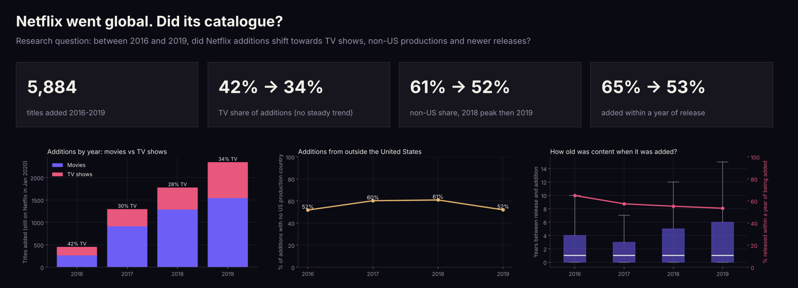

# How did Netflix's catalogue change as it went global?



*Summary dashboard, generated by the notebook from the results.*


## Research question

Between 2016 and 2019, as Netflix expanded worldwide, did the titles it **added** shift towards:

1. TV shows rather than films,
2. productions from outside the United States, and
3. newer releases?

## Data

[Netflix Movies and TV Shows](https://www.kaggle.com/datasets/shivamb/netflix-shows) by Shivam Bansal on Kaggle. This analysis uses the January 2020 release: 6,234 titles that were on Netflix at that point, each with the date it was added. After removing 11 titles with no date and 3 duplicates, 5,884 titles were added in 2016–2019.

The CSV is not included in this repo. The notebook uses `netflix_titles.csv` if it is next to it, and otherwise downloads a public copy of the same January 2020 release.

## Method

- Titles grouped by the calendar year they were added (2016–2019, the four full years with enough additions to compare).
- **TV vs film:** chi-square test of type by year, plus a logistic regression for a year-on-year trend.
- **Outside the US:** a title counts as non-US if none of its listed production countries is the United States (451 titles with no country were excluded). Logistic regression for the trend.
- **Newer releases:** years between release and addition; Kruskal–Wallis across years, and a logistic regression on whether a title was added within a year of release.

## Findings

| Year added | Titles | TV share | Non-US share | Released within a year |
|---|---|---|---|---|
| 2016 | 456 | 42% | 52% | 65% |
| 2017 | 1,299 | 30% | 60% | 57% |
| 2018 | 1,782 | 28% | 61% | 55% |
| 2019 | 2,347 | 34% | 52% | 53% |

1. **TV shows: no steady shift.** The mix differed between years (χ² = 45.2, p < 0.001), but there was no year-on-year trend (odds ×0.99 per year, p = 0.72).
2. **Outside the US: a rise, then a fall back.** Non-US additions rose from 52% to 61% by 2018, then returned to 52% in 2019. Overall the trend was slightly *down* (odds ×0.92 per year, p = 0.005). India drove much of the middle: from 15 additions in 2016 to 363 in 2018, then 248 in 2019. In absolute terms, non-US additions still grew more than four-fold.
3. **Newer releases: the opposite.** The share of additions released within a year fell from 65% to 53% (odds ×0.89 per year, p < 0.001; Kruskal–Wallis p < 0.001). Later years added more back catalogue, not less.

The headline: Netflix added five times more titles in 2019 than in 2016, but the *mix* stayed broadly the same. The growth was across the board rather than a swap from films to series or from American to international content.

## Methods and what I learnt

| Method | What it taught me |
|---|---|
| **Chi-square test of independence** | It showed the TV/film mix *differed* between years, but not that it was trending. A significant test is not the same as a direction. |
| **Logistic regression on year** | Modelling the yearly change as odds (×0.99 per year for TV) separated a real trend from year-to-year noise. |
| **Kruskal–Wallis test** | A rank-based test suited content age, which is heavily skewed, better than comparing means. |
| **Thinking about survivorship bias** | The data only contains titles still on Netflix in 2020. Asking "what's missing, and which way does it push the result?" changed how strongly I could state the findings. |
| **Exploding multi-value fields** | Production countries come as comma-separated lists, so I had to split them before counting without double-counting titles in share calculations. |

## Limitations

- **Survivorship.** The data only includes titles still on Netflix in January 2020. Titles added earlier and later removed are missing, and licensed content is removed more often than originals. This under-counts earlier years and could make early additions look newer than they were.
- **Production country is not audience.** A non-US production country says where a title was made, not who it was made for.
- **One snapshot.** Later Kaggle releases cover 2020–21 and would test whether these patterns held.

## Run it

```bash
pip install pandas numpy matplotlib scipy statsmodels jupyter
jupyter notebook netflix_catalogue_analysis.ipynb
```

The figures and dashboard in `figures/` are produced by the notebook.

---

**Suwaasha Murugaperumal** · [Portfolio](https://suwaasham.github.io) · [LinkedIn](https://www.linkedin.com/in/suwaasham/) · [GitHub](https://github.com/SuwaashaM)
